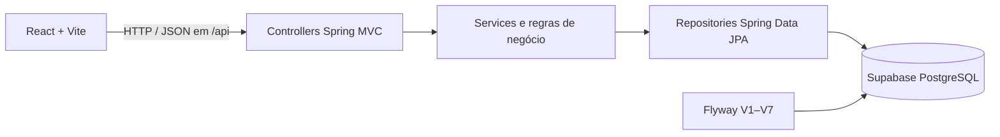

# 🚘 Sistema de Aluguel de Carros

Aplicação web acadêmica para consultar automóveis e gerenciar pedidos de aluguel. Clientes criam e acompanham solicitações; empresas e bancos analisam os pedidos; depois da aprovação, o cliente pode executar o contrato. Um banco também pode associar um contrato de crédito ao aluguel.

> Projeto desenvolvido para a disciplina de Desenvolvimento e Integração de Aplicações Web, com orientação do professor João Paulo Carneiro Aramuni.


---

## 📚 Índice

- [Links úteis](#-links-úteis)
- [Sobre o projeto](#-sobre-o-projeto)
- [Como o sistema funciona](#-como-o-sistema-funciona)
- [Funcionalidades](#-funcionalidades-principais)
- [Tecnologias](#-tecnologias-utilizadas)
- [Arquitetura](#-arquitetura)
- [Instalação e execução](#-instalação-e-execução)
- [Estrutura do código](#-estrutura-de-pastas)
- [Demonstração](#-demonstração)
- [Testes](#-testes)
- [Documentação](#-documentações-utilizadas)
- [Autor e agradecimentos](#-autores-e-agradecimentos)
- [Licença](#-licença)

## 🔗 Links úteis

- [Repositório GitHub](https://github.com/lucasomafia/Aluguel-de-carros)
- [Wireframes editáveis no Figma](https://www.figma.com/design/5cT6LQGGLK7wobxhB88722?node-id=3-2)
- [Guia de acesso aos wireframes](docs/wireframes.docx)
- [Modelagem UML — versão atual](docs/modelagem/v2/modelagem.md)
- [Casos de uso](docs/modelagem/v2/casos-de-uso.puml)
- [Diagrama de classes](docs/modelagem/v2/classes.puml)
- [Diagrama de pacotes](docs/modelagem/v2/pacotes.puml)
- [Histórias de usuário](docs/modelagem/v2/historias-de-usuario.md)
- [Template de README do professor](https://github.com/joaopauloaramuni/desenvolvimento-e-integracao-de-aplicacoes-web/blob/main/TEMPLATES/template_README.md)

Não há demonstração hospedada em produção no momento; a aplicação é executada localmente.

## 📝 Sobre o projeto

O sistema centraliza o fluxo de aluguel de automóveis pela Internet. O cliente informa seus dados e rendimentos, escolhe um veículo e acompanha a análise financeira. Os agentes empresa e banco podem consultar, modificar e avaliar pedidos. Quando um pedido é aprovado, o cliente pode executar o contrato e definir se o automóvel ficará registrado em seu nome ou no nome do agente que aprovou a solicitação.

O banco pode, opcionalmente, registrar um crédito associado ao contrato, com valor e número de parcelas. O protótipo não calcula juros nem controla pagamentos das parcelas.

## 🔄 Como o sistema funciona

1. **Cadastro e acesso:** o cadastro público cria uma conta de cliente. O cliente entra com usuário e senha; os agentes usam contas provisionadas para os perfis empresa e banco.
2. **Dados do cliente:** o cliente informa RG, CPF, endereço, profissão e até três entidades empregadoras com seus rendimentos.
3. **Consulta de automóveis:** após autenticar-se, o usuário acessa a página inicial e consulta os veículos cadastrados; o cliente pode iniciar um pedido.
4. **Pedido de aluguel:** o cliente escolhe automóvel e datas de retirada e devolução. Pode consultar, alterar ou cancelar o pedido enquanto ele está pendente de análise.
5. **Análise financeira:** empresa e banco consultam os pedidos, podem ajustar os dados do pedido e registram aprovação ou rejeição com parecer.
6. **Contrato:** após aprovação, o cliente executa o contrato e escolhe a propriedade do automóvel: cliente ou agente responsável pela aprovação. A execução atualiza o status do pedido e o proprietário registrado do veículo.
7. **Crédito opcional:** o banco pode associar um crédito ao contrato executado, informando valor e de 1 a 120 parcelas. Cada contrato aceita no máximo um crédito.

## ✨ Funcionalidades principais

- Cadastro de clientes e autenticação obrigatória para operações protegidas.
- Autorização de operações conforme o perfil: `CLIENTE`, `EMPRESA` ou `BANCO`.
- Cadastro, consulta, alteração e exclusão dos dados de cliente.
- Cadastro de até três vínculos empregatícios e respectivos rendimentos.
- Consulta autenticada de automóveis e gerenciamento de veículos pelos agentes.
- Criação, consulta, alteração, avaliação e cancelamento de pedidos, com controle de status.
- Execução de contrato após aprovação financeira e atualização da propriedade do automóvel.
- Concessão e consulta de crédito vinculado a contrato por agentes do perfil banco.
- Persistência PostgreSQL no Supabase e migrações de banco com Flyway.

## 🛠 Tecnologias utilizadas

As versões abaixo correspondem às versões declaradas no `pom.xml` e no `package.json` do projeto.

### Front-end

| Tecnologia | Versão / uso |
| --- | --- |
| React | 19.3.1 |
| React DOM | 19.3.1 |
| JavaScript | ES Modules |
| Vite | 8.3.6 |
| Node.js | 20.19+, 22.13+ ou 24+ (requisito das ferramentas instaladas) |
| Estilos | CSS próprio, sem biblioteca de componentes |

### Back-end e dados

| Tecnologia | Versão / uso |
| --- | --- |
| Java / JDK | 25 |
| Spring Boot | 4.0.9 |
| Spring MVC | API REST e arquitetura MVC |
| Maven | Build e dependências; o repositório não inclui Maven Wrapper |
| Supabase | PostgreSQL hospedado, acessado pelo driver JDBC |


O login é implementado pela aplicação com Spring Security. O Supabase é utilizado como banco PostgreSQL; o projeto não utiliza o serviço Supabase Auth.

As rotas autenticadas usam HTTP Basic sem sessão no servidor. Na interface, a credencial fica em memória durante o uso; atualizar a página encerra o acesso e exige novo login.

## 🏗 Arquitetura

O back-end segue MVC em camadas. Os controllers recebem as requisições HTTP e validam os dados de entrada; os services aplicam as regras do sistema; os repositories acessam as entidades por meio de Spring Data JPA. DTOs definem os formatos de entrada e saída da API. O Spring Security protege as rotas e verifica os perfis.

O front-end é uma aplicação React/Vite. A interface usa a API REST em `/api`; durante o desenvolvimento, o servidor Vite encaminha essas chamadas para `http://localhost:8080`. A aplicação não possui serviço separado para renderização dinâmica: as telas e estados são controlados pelo React no navegador.



Os diagramas de classes, pacotes e casos de uso estão em [`docs/modelagem/v2`](docs/modelagem/v2/modelagem.md).

### Principais rotas da API

| Método e rota | Acesso / finalidade |
| --- | --- |
| `POST /api/auth/cadastro` | Público; cria conta de cliente |
| `POST /api/auth/login` | Autenticado com HTTP Basic; retorna os dados da conta |
| `GET /api/auth/me` | Autenticado; consulta a conta atual |
| `GET /api/automoveis` | Autenticado; lista automóveis |
| `GET /api/clientes/me`, `PUT /api/clientes/me`, `DELETE /api/clientes/me` | Autenticado como cliente; consulta, cria/atualiza ou remove os dados de cliente |
| `GET /api/pedidos/me` | Cliente; lista seus pedidos |
| `GET /api/pedidos` | Empresa ou banco; lista pedidos para análise |
| `POST /api/pedidos` | Cliente autenticado; cria pedido |
| `POST /api/pedidos/{id}/avaliacao` | Empresa ou banco; registra parecer e decisão |
| `POST /api/contratos` | Cliente; executa contrato de pedido aprovado |
| `POST /api/creditos` | Banco; concede crédito para contrato executado |

## 🔧 Instalação e execução

### Pré-requisitos

- JDK 25.
- Node.js 20.19+, 22.13+ ou 24+, e npm.
- Maven instalado (não há `mvnw` no repositório).
- Um projeto Supabase com acesso PostgreSQL e senha do banco.

### Configurar o banco e as variáveis

Na pasta `backend`, copie o arquivo de exemplo e preencha com os dados de conexão do Supabase:

```bash
cd backend
cp .env.example .env
```

Edite `backend/.env`:

```dotenv
BANCO_URL=jdbc:postgresql://SEU_HOST:5432/postgres?sslmode=require
BANCO_USUARIO=SEU_USUARIO
BANCO_SENHA=SUA_SENHA

# Opcional: provisiona um agente na inicialização, se o usuário ainda não existir.
AGENTE_USUARIO=empresa.local
AGENTE_SENHA=troque-por-uma-senha-forte
AGENTE_NOME=Empresa de aluguel
AGENTE_PERFIL=EMPRESA
```

Para `BANCO_URL`, `BANCO_USUARIO` e `BANCO_SENHA`, use os dados de conexão PostgreSQL do projeto Supabase. Nunca publique o arquivo `.env` nem substitua esses valores por credenciais reais no README. O arquivo `.env.example` contém somente valores ilustrativos.

Ao iniciar, o Flyway executa automaticamente as migrações `V1` a `V7`. O Hibernate valida o schema, sem criá-lo ou alterá-lo automaticamente.

### Instalar dependências

Na raiz do repositório:

```bash
npm install
```

O Maven baixa as dependências do back-end ao executar os comandos abaixo.

### Iniciar o back-end

Em um terminal:

```bash
cd backend
mvn spring-boot:run
```

A API ficará em `http://localhost:8080`.

### Iniciar o front-end

Em outro terminal, na raiz do projeto:

```bash
npm run dev
```

A interface ficará em `http://127.0.0.1:5173`. O proxy do Vite encaminha `/api` para o back-end na porta 8080.

### Build de produção

```bash
# Na raiz: gera os arquivos estáticos do front-end em dist/
npm run build

# No diretório backend: gera o JAR do back-end
cd backend
mvn clean package
```

O projeto não contém configuração de deploy, Docker ou Compose. Para publicar, é necessário hospedar o front-end estático e o back-end separadamente e configurar as variáveis de conexão no ambiente do servidor.

## 📂 Estrutura de pastas

```text
.
├── README.md
├── package.json                 # Scripts e dependências do React/Vite
├── src/
│   ├── App.jsx                  # Telas, estado e fluxos da interface
│   ├── index.css                # Estilos da aplicação
│   └── main.jsx                 # Inicialização do React
├── public/                      # Imagens usadas na interface
├── docs/modelagem/v2/           # Diagramas UML e histórias de usuário
└── backend/
    ├── pom.xml                  # Dependências e build Maven
    └── src/
        ├── main/java/br/com/aluguel/
        │   ├── config/          # Segurança e provisionamento inicial de agente
        │   ├── controller/      # Endpoints REST
        │   ├── dto/             # Objetos de requisição e resposta
        │   ├── model/           # Entidades e enums
        │   ├── repository/      # Acesso a dados
        │   └── service/         # Regras de negócio
        ├── main/resources/
        │   ├── application.properties
        │   └── db/migration/    # Migrações Flyway V1–V7
        └── test/java/           # Testes de integração
```

## 🎥 Demonstração

Não há GIF ou capturas de tela versionadas no repositório. Para demonstrar localmente, inicie o back-end e o front-end conforme as instruções acima e acesse `http://127.0.0.1:5173`.

### Contas de demonstração

Estas contas foram criadas no projeto Supabase atualmente usado pelo desenvolvimento. Elas não são criadas automaticamente em outro banco; para uma instalação própria, cadastre um cliente pela interface e use `AGENTE_*` para provisionar um agente inicial. Essa configuração provisiona um único agente por execução; contas adicionais de agentes precisam ser provisionadas pelo responsável pelo banco.

| Perfil | Usuário | Senha |
| --- | --- | --- |
| Cliente | `cliente.87bb8a` | `4463zPkMcn4LQOlbU5wpsKFJ` |
| Empresa | `empresa.87bb8a` | `utXnu5Rq6SG6iq2gxQI8tD9r` |
| Banco | `banco.87bb8a` | `DKNkQehMlzUX9hdoQs4Ce3OB` |

## 🧪 Testes

O back-end contém testes de integração com Spring Boot Test, JUnit e H2 em memória. Para executá-los:

```bash
cd backend
mvn test
```

Os testes cobrem autenticação, dados do cliente, automóveis, pedidos, contratos e créditos. Não há script de testes automatizados de front-end ou E2E configurado no `package.json`.

## 🔗 Documentações utilizadas

- [Spring Boot](https://docs.spring.io/spring-boot/)
- [Spring Security](https://docs.spring.io/spring-security/reference/)
- [React](https://react.dev/)
- [Vite](https://vite.dev/)
- [Supabase — PostgreSQL](https://supabase.com/docs/guides/database/overview)
- [Flyway](https://documentation.red-gate.com/flyway)
- [Template README do professor](https://github.com/joaopauloaramuni/desenvolvimento-e-integracao-de-aplicacoes-web/blob/main/TEMPLATES/template_README.md)
